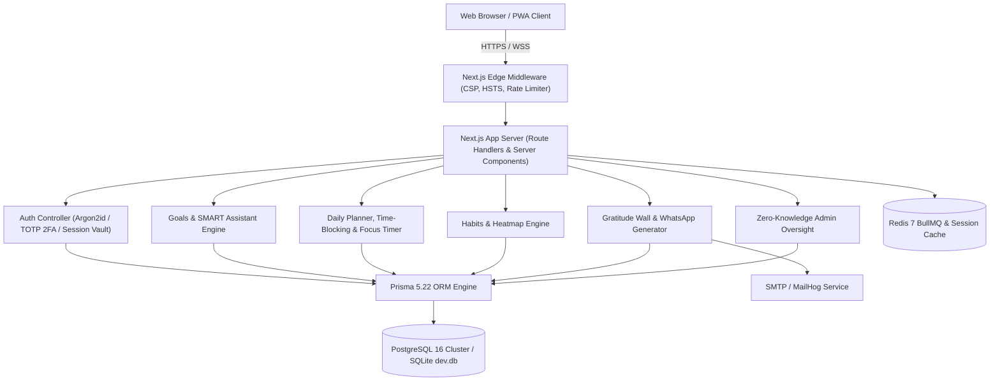
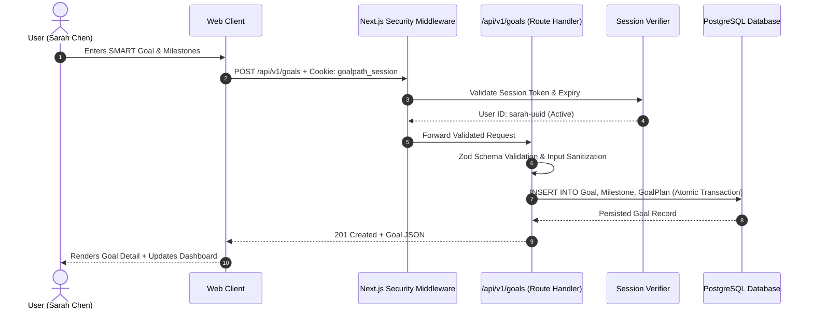
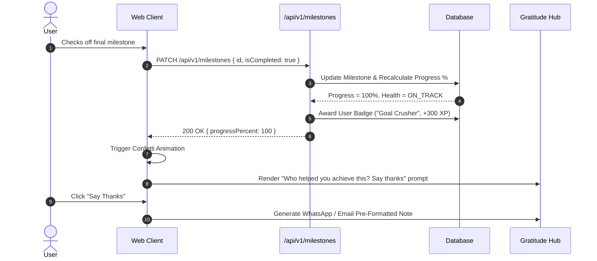

# GoalPath - Enterprise System Architecture Specification (ARCHITECTURE.md)

---

## 1. System Overview

**GoalPath** is an enterprise-grade multi-tenant SaaS platform built to unify long-term goal deconstruction, daily time-blocking, habit consistency, and interpersonal gratitude into a high-performance execution engine.

### 1.1 Core Architectural Principles
1. **Stateless Web Tier**: Next.js 14 App Router server handles client requests without storing in-memory user sessions. Sessions are persisted in relational storage and validated via signed HttpOnly cookies.
2. **Strict Multi-Tenant Row-Level Isolation**: Every query accessing user resources (Goals, Tasks, Milestones, Habits, Journals) enforces strict ownership filters (`WHERE id = :id AND userId = :currentUserId`), completely eliminating IDOR/BOLA attack vectors.
3. **Zero-Knowledge Administration Boundary**: Platform administrators have zero visibility into private user content (goal titles, emotional "why it matters" anchors, daily gratitude journals). Administrative consoles display aggregate quantitative metrics only.
4. **Resilient Local-First Execution**: The application runs with zero external infrastructure dependencies in development (SQLite + Next.js), while providing dual-compatible migration schemas for distributed PostgreSQL + Redis in enterprise production.

---

## 2. High-Level Component Topology

---

## 3. Data Flow & Sequence Workflows

### 3.1 Authenticated Goal Creation & Milestone Decomposition

### 3.2 Milestone Completion & Gratitude Trigger Flow

---

## 4. Database Schema & Modeling Architecture

| Model Name | Role | Primary Key | Foreign Keys | Cascade Policy |
|---|---|---|---|---|
| `User` | User identity & security credentials | `id` (UUID) | - | - |
| `Session` | Active authenticated device session | `id` (UUID) | `userId` $\rightarrow$ `User.id` | CASCADE on user delete |
| `Goal` | Core North Star objective | `id` (UUID) | `userId` $\rightarrow$ `User.id` | CASCADE on user delete |
| `Milestone` | Deconstructed stage of a goal | `id` (UUID) | `goalId` $\rightarrow$ `Goal.id` | CASCADE on goal delete |
| `Task` | Atomic executable action | `id` (UUID) | `userId`, `goalId`, `milestoneId` | SET NULL on goal delete |
| `TimeBlock` | Scheduled timeline calendar slot | `id` (UUID) | `userId`, `taskId` | CASCADE on user delete |
| `Habit` | Recurring discipline tracker | `id` (UUID) | `userId`, `goalId` | CASCADE on user delete |
| `HabitLog` | Daily completion / skip state | `id` (UUID) | `habitId` $\rightarrow$ `Habit.id` | CASCADE on habit delete |
| `SupportPerson` | Gratitude network champion | `id` (UUID) | `userId`, `goalId` | CASCADE on user delete |
| `ThankYouNote` | Acknowledgment message record | `id` (UUID) | `userId`, `supportPersonId` | CASCADE on person delete |
| `Group` | Mastermind team / cohort | `id` (UUID) | `ownerId` $\rightarrow$ `User.id` | CASCADE on owner delete |
| `GroupMember` | Team membership & RBAC role | `id` (UUID) | `groupId`, `userId` | CASCADE |
| `AuditLog` | Tamper-evident security trail | `id` (UUID) | `userId` $\rightarrow$ `User.id` | SET NULL on user delete |

---

## 5. Security & Isolation Architecture

1. **Defense-in-Depth Layering**:
   - Edge headers: Strict CSP, HSTS, X-Content-Type-Options: nosniff, X-Frame-Options: DENY.
   - Request-level sliding-window rate limiting on login, signup, and reset routes.
   - Cryptographic Argon2id password hashing with work factor 12.
   - RFC 6238 TOTP Two-Factor Authentication with encrypted recovery backup codes.
2. **Zero-Knowledge Admin Guarantees**:
   - The `/admin` routes do not join against user `Goal`, `Task`, or `GratitudeEntry` tables.
   - Administrative search queries return user metadata and aggregate counts (`_count { goals, habits }`), preserving privacy.
3. **Data Portability & Right to Erasure**:
   - `/api/v1/user/export`: Streams complete user records in JSON and CSV formats.
   - `/api/v1/user/delete`: Cryptographically verifies password and confirmation phrase, cascades deletes across all relational rows, and clears cookies.
