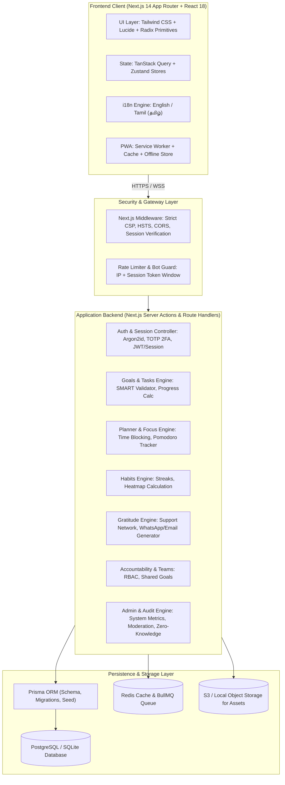
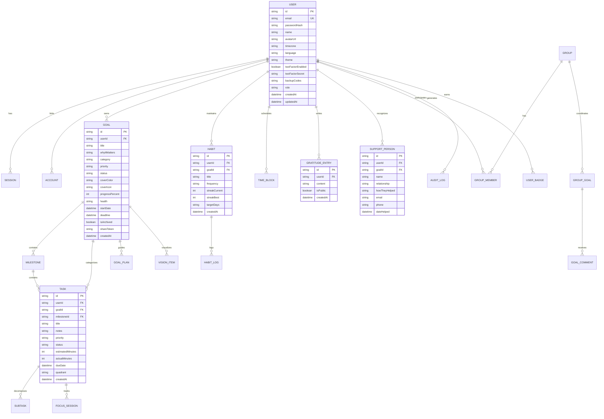

# GoalPath - Production-Grade SaaS Web Platform
## Comprehensive Master Plan & Architecture Specification (PLAN.md)

---

### Executive Summary & Team Roles

**GoalPath** is an enterprise-ready, production-grade multi-user SaaS platform built for high-achieving professionals, teams, and students to plan their days, manage time, achieve ambitious goals, foster unbreakable habits, and express sincere gratitude to those who support their journey.

This engineering plan is formulated by our joint four-expert council:
1. **Principal Full-Stack Engineer**: Next.js 14 App Router, TypeScript strict mode, Prisma ORM, REST API v1 architecture, state management with TanStack Query & Zustand, and UI component architecture.
2. **Senior UI/UX Designer**: Calm, premium design system (WCAG 2.2 AA compliant), responsive layouts (320px mobile to 4K desktop), dark/light/system themes, English & Tamil (தமிழ்) internationalization, and Nielsen's 10 Heuristics compliance.
3. **Cybersecurity Engineer**: Secure-by-design posture, STRIDE threat modeling, OWASP Top 10 / ASVS Level 2 compliance, strict Content Security Policy, Argon2id/cryptographic password hashing, RBAC authorization, anti-CSRF/XSS, and audit logging.
4. **DevOps / SRE Engineer**: Zero-downtime architecture, Docker containerization, CI/CD pipeline, health checks, k6 load testing, automated backup runbooks, and multi-cloud / self-hosted deployment options.

---

### 1. Product Specification

#### 1.1 Accounts and Profile
- **Authentication**: Email + password with Argon2id cryptographic hashing, password breach checks, Google OAuth sign-in flow, magic link authentication.
- **Security & 2FA**: Email verification, secure token-based forgot/reset password, Time-based One-Time Password (TOTP) 2FA with authenticator apps (Google Authenticator / Aegis) and cryptographic emergency backup recovery codes.
- **Profile Management**: Display name, avatar upload/preview, timezone selection, language preference (English `en` / Tamil `ta`), visual theme preference (`light`, `dark`, `system`).
- **Onboarding Wizard**: Guided multi-step experience:
  1. Primary focus area / core North Star goal
  2. Category selection (Business, Study, Career, Health, Finance, Personal)
  3. Daily routine and core working hours
  4. Demo seed data option to immediately explore a populated workspace.
- **Account Lifecycle & Privacy**: Granular device session management ("Log out all other devices"), complete GDPR/DPDP-compliant data export (JSON & CSV), and account deletion with permanent data shredding.

#### 1.2 Goals Engine
- **Core Entities**: Title, "Why it matters" emotional anchor, category tag, start date, deadline, priority (`LOW`, `MEDIUM`, `HIGH`, `URGENT`), status (`NOT_STARTED`, `IN_PROGRESS`, `COMPLETED`, `ARCHIVED`), cover color and icon.
- **Hierarchy**: Goal $\rightarrow$ Milestones $\rightarrow$ Tasks $\rightarrow$ Subtasks.
- **SMART Goal Assistant**: Interactive wizard auditing Specific, Measurable, Achievable, Relevant, and Time-bound criteria before publishing.
- **Strategic Execution Plan ("How I will achieve this")**: Action steps, required equipment/resources, obstacles + pre-planned countermeasures, and accountability support champions.
- **Automated Metric Progress**: Mathematical progress calculation based on completed milestones and tasks; automated health index (`ON_TRACK`, `AT_RISK`, `BEHIND`).
- **Vision Board**: Media gallery with motivational imagery, target metrics, and inspirational notes.
- **Goal Templates**: One-click cloneable templates: "Crack an Examination", "Launch a SaaS Venture", "Run a Marathon", "Learn Full-Stack Engineering".
- **Collaboration**: Exportable read-only public sharing links with tokenized access control.

#### 1.3 Daily Planner & Time Management
- **Planner Views**: Dynamic timeline view (6:00 AM to 11:00 PM), priority task list, and Kanban board (`To Do`, `In Progress`, `Done`).
- **Time Blocking**: Interactive drag-and-drop scheduling, duration resizing, recurring task support (Daily, Weekly, Weekdays).
- **Prioritization**: Dedicated "Top 3 Priorities of the Day", Eisenhower Matrix quadrant categorization (Urgent & Important, Important & Not Urgent, Urgent & Not Important, Neither).
- **Task Metadata**: Rich notes, linked goal reference, estimated time vs. actual time tracking, tags, reminders.
- **Smart Rollover**: Uncompleted items automatically surfaced for the next morning with rollover prompt.
- **Pomodoro & Focus Timer**: 25/5 interval timer, ambient audio triggers (Rain, White Noise, Cafe, Stream), automatic time-logging directly tied to specific goals and tasks.
- **Calendar Integrations**: Day, Week, and Month views, with standard bidirectional `.ics` iCalendar calendar export.
- **Natural Language Quick-Add**: Parsing heuristics (e.g., "Study algorithms tomorrow 6pm for 2 hours").

#### 1.4 Habits Engine
- **Cadence**: Daily, specific days per week, and custom intervals.
- **Gamification & Heatmap**: GitHub-style activity heatmaps, current streak, all-time best streak, and intelligent "rest/skip days" that preserve streak integrity.
- **Goal Linkage**: Direct association with overarching goals to reinforce habitual behavior.

#### 1.5 Gratitude Wall & Support Network (Signature Feature)
- **Support Network Directory**: Name, relationship, contact details, linked goal, contribution note, and support date.
- **Thank-You Note Generator**: Pre-formatted appreciative templates with instant copy, WhatsApp direct message links (`api.whatsapp.com/send?text=...`), and email drafting.
- **Daily Gratitude Journal**: Daily prompt entry ("Today I am thankful for...").
- **Achievement Prompt**: Triggered upon 100% goal completion: "Who made this possible? Send a thank-you note."
- **Gratitude Wall**: Private journal by default with user-toggleable public wall feed.
- **Monthly Cadence Reminder**: Automated reminder to show gratitude to mentors and champions.

#### 1.6 Accountability, Groups & Mentorship
- **Accountability Partner**: Direct member-to-member invitations, shared goal progress dashboards, and motivation nudges ("Send high-five").
- **Teams & Communities**: Organization/cohort workspace creation, shared group objectives, collaborative leaderboard, and group challenges (e.g., "30-Day Deep Work Challenge").
- **Role-Based Access Control**: `OWNER`, `ADMIN`, `MEMBER`, `VIEWER`.
- **Engagement**: Comments and emoji reactions on shared achievements.
- **Mentor Mode**: Read-and-advise role allowing mentors to inspect mentee goals with explicit authorization and attach actionable advice.

#### 1.7 Reviews, Analytics & Motivation
- **Productivity Dashboard**: Today completion %, weekly/monthly velocity graphs, time distribution per category, active streaks, and impending deadlines.
- **Review Wizards**: Structured Weekly and Monthly Retrospective wizards (Wins, Blockers, Lessons, Adjustments) with pre-populated quantitative statistics.
- **Badges & XP Gamification**: Level progression, achievement unlocks, celebratory confetti on goal fulfillment.
- **Daily Motivation**: Dynamic motivational wisdom and daily North Star reminders.
- **AI Strategic Coach**: Opt-in privacy-preserving coach analyzing weekly patterns, recommending schedule optimizations, and decomposing large milestones into atomic tasks.

#### 1.8 Platform Administration & Governance
- **Protected `/admin` Control Center**: Active tenant counts, daily/monthly active users, aggregate velocity, error rates, and system health.
- **User Governance**: Search, status suspension, deletion, and role management. Impersonation is strictly disallowed to guarantee privacy.
- **Zero-Knowledge User Data**: Strict boundary ensuring private goals and gratitude journals are inaccessible to admin eyes.
- **Audit Log Console & Moderation**: Security event audit logs, moderation queue for reported public gratitude posts, and dynamic feature flag controls.

---

### 2. Architecture Diagram

---

### 3. Entity Relationship Diagram (ERD)

---

### 4. STRIDE Threat Model & Mitigations

| Threat Category | Potential Attack Vector | Applied Mitigation Architecture |
|---|---|---|
| **Spoofing** | Credential theft, session hijacking, fake identity token injection | Argon2id password hashing, HTTP-only secure SameSite=Strict cookies, rotating session tokens, mandatory 2FA TOTP option, progressive account lockouts. |
| **Tampering** | Parameter manipulation, IDOR (Insecure Direct Object Reference) on goals/tasks | Strict Zod validation on every endpoint, mandatory tenant verification (`WHERE id = :id AND userId = :currentUserId`) on every single query. |
| **Repudiation** | Denying an administrative deletion or unauthorized modification | Tamper-evident Audit Log recording actor ID, IP address, user agent, event action, and timestamp. Logs are immutable and append-only. |
| **Information Disclosure** | Data leakage in error stacks, admins reading private journals, public data scraping | Production error-masking, Zero-Knowledge Admin architecture (Admin panel has zero access to user goals/journals), encrypted field storage for private entries. |
| **Denial of Service** | Resource starvation via brute force login, unbounded query requests | In-memory & Redis sliding-window rate limiting on all `/api/v1/auth/*` and mutation routes; pagination caps (`limit <= 100`) on all collection queries. |
| **Elevation of Privilege** | Normal user altering role to ADMIN via mass assignment | Server-side role assignment exclusively; strict Zod schemas omitting role fields from client-facing profile update endpoints. |

---

### 5. Risk Assessment & Engineering Mitigations

1. **Risk: Browser/Client Offline Disruption**
   - *Mitigation*: Service worker caching for the Today Planner view, local indexed/optimistic store, and background queue synchronization when connectivity is restored.
2. **Risk: Performance Lag with Large Goal Trees**
   - *Mitigation*: Compound database indexing on `(userId, status, dueDate)`, pagination on subtask lists, and shallow JSON responses with TanStack Query memoization.
3. **Risk: Internationalization Rendering Distortions**
   - *Mitigation*: Dynamic font fallback accommodating Tamil glyphs seamlessly (`Noto Sans Tamil` / system font stack), localized date-time formatting using `Intl.DateTimeFormat`.
4. **Risk: Secret Leakage & Insecure File Uploads**
   - *Mitigation*: Strict environment validation via Zod, rejection of client uploads without signed URLs, MIME-type and magic-byte validation, and automated `.gitignore` audits.

---

### 6. Phase-by-Phase Build Roadmap

- **Phase 1: Foundation & Security Baseline**
  - Project configuration, design tokens, security headers (CSP, HSTS), Prisma schema, seed script, authentication engine (Argon2id, sessions, 2FA TOTP, login/signup/reset), RBAC middleware.
- **Phase 2: Goal Engine**
  - Goals CRUD, SMART wizard, milestones, tasks, subtasks, progress calculation, templates, vision boards, shareable links.
- **Phase 3: Daily Planner & Focus Management**
  - Timeline, Eisenhower matrix, drag-and-drop time blocking, Pomodoro focus timer with ambient sound generators, `.ics` calendar sync.
- **Phase 4: Habits Engine**
  - Habit tracking, streaks calculation, skip days, GitHub-style interactive heatmap, goal linkage.
- **Phase 5: Gratitude Wall & Support Network**
  - Support directory, WhatsApp & email thank-you generator, daily gratitude journal, achievement prompt, public gratitude wall.
- **Phase 6: Accountability, Groups & Mentorship**
  - Accountability partner pairing, group workspaces, shared challenges, mentor review mode, notifications.
- **Phase 7: Analytics, Reviews & AI Coach**
  - Quantitative charts (Recharts), weekly/monthly retrospective wizard, badges & XP, confetti celebration, opt-in AI strategic coach.
- **Phase 8: Admin Center & Privacy Tools**
  - Protected `/admin` dashboard, user management, audit log inspector, content moderation, GDPR JSON/CSV data export and permanent account deletion.
- **Phase 9: Security Hardening & Performance Optimization**
  - Automated security tests (auth bypass, IDOR, rate limiting), OWASP audit, Lighthouse & k6 load testing, accessibility checks.
- **Phase 10: Operations, Containerization & Delivery**
  - Production Dockerfile, docker-compose, CI/CD GitHub Actions workflow, Terraform specs, RUNBOOK.md, DEPLOYMENT.md, screenshots gallery.
