# GoalPath 🎯 - Production-Grade SaaS Web Platform
### Plan Your Day. Achieve Big Goals. Build Habits. Thank Who Helped.

[](https://nextjs.org/)
[](https://www.typescriptlang.org/)
[](https://www.prisma.io/)
[](https://redis.io/)
[](SECURITY_REPORT.md)
[](PERFORMANCE_REPORT.md)

---

## 🌟 Executive Overview

**GoalPath** is an enterprise-grade multi-tenant web platform designed for high-achieving professionals, founders, and teams. Built by a four-expert engineering council (Principal Full-Stack Engineer, Senior UI/UX Designer, Cybersecurity Engineer, and DevOps/SRE Engineer), it seamlessly connects long-term ambition to daily execution while honoring the human network that makes success possible.

---

## 🔒 Security Hardening & Zero-Trust Architecture

Following an external hostile penetration testing audit, the entire codebase was audited and hardened against OWASP Top 10 vulnerabilities:
- **Authentication**: Cryptographic password hashing, RFC 6238 TOTP 2FA + backup codes, cryptographic password reset tokens with 15-minute TTL.
- **Session Management**: Distributed Redis session store (`session:${token}`) supporting multi-instance deployments, instant cross-instance logout, and suspension purges.
- **Authorization**: Row-level multi-tenant tenant isolation on every endpoint (`userId: user.id`), preventing IDOR/BOLA on goals, tasks, comments, habits, and support people.
- **Input Sanitization & Mass Assignment**: Server-side Zod validation, text sanitization, strict whitelisting on updates, protocol injection prevention (`javascript:` URI rejection).
- **Rate Limiting**: Distributed Redis sliding-window rate limiting on both IP and account email (`login:email:${email}`).
- **Hardened Production Controls**: Demo switch bar removed, hardcoded passwords removed, seed script guarded against accidental execution in production (`ALLOW_PRODUCTION_SEED=true` required).

---

## ⚡ Core Features

### 1. Goals Engine & SMART Assistant
- Deconstruct ambitious vision into: Goal $\rightarrow$ Milestones $\rightarrow$ Tasks $\rightarrow$ Subtasks.
- Guided **SMART Goal Assistant** checking Specific, Measurable, Achievable, Relevant, and Time-bound parameters.
- **"How I will achieve this"** execution plan per goal: daily action steps, required resources, obstacles + solutions.
- Mathematical progress calculation with automated health indicator (`On Track`, `At Risk`, `Behind`).
- **One-click cloneable templates**: "Crack an Exam", "Launch a SaaS Venture", "Run a Marathon".
- Read-only tokenized public sharing links (`/shared/goal/[shareToken]`).

### 2. Daily Planner & Time Management
- **Today Page with 4 Views**: Timeline (6 AM to 11 PM), List View, Kanban Board, and Eisenhower Matrix (Urgent / Important).
- Visual time-blocking and scheduling.
- **Top 3 Priorities of the Day** widget.
- **Unfinished task auto-rollover** to tomorrow with a prompt.
- **Pomodoro Focus Timer** with built-in ambient audio generators (Rain, Stream, Cafe) using client-side Web Audio API.
- Standard bidirectional `.ics` calendar export.
- Natural language quick-add bar ("Study algorithms tomorrow 2pm for 2 hours").

### 3. Habits Engine
- Daily, weekly, and custom frequency tracking.
- Current streak and all-time best streak calculation.
- GitHub-style **28-day & 90-day activity heatmaps**.
- **Skip / Rest days** that preserve consistency streaks without breaking momentum.
- Direct linkage between habits and overarching goals.

### 4. Gratitude & Support Network (Signature Feature)
- **"Who helped me"** support directory with contact details, linked goals, and contribution notes.
- **Thank-You Note Generator** with instant copy, direct WhatsApp Web links (`api.whatsapp.com/send?text=...`), and email drafting.
- Daily Gratitude Journal ("Today I am genuinely grateful for...").
- **Goal Completion Celebration**: Confetti animation and automatic prompt: *"Who helped you achieve this? Say thanks."*
- Community Public Gratitude Wall with reactions and monthly gratitude reminder banners.

### 5. Accountability, Community & Mentorship
- Accountability partner pairing and shared milestone tracking.
- Mastermind groups and cohorts with dynamic cryptographic invite codes.
- Group goals and **30-Day Streak Challenges**.
- **Mentor Mode**: Read-and-advise role allowing mentors to review mentee progress with explicit authorization.

### 6. Reviews, Analytics & Motivation
- Velocity charts: Weekly deep work minutes and category distribution progress.
- Guided **Weekly & Monthly Retrospective Wizard** (Wins, Blockers, Lessons, Adjustments) with pre-filled quantitative stats.
- Gamification badges, XP levels, and level progression.
- **Opt-In AI Strategic Coach**: Analyzes weekly patterns and deconstructs complex goals into actionable milestones.

### 7. Zero-Knowledge Admin Console & Privacy Controls
- Role-protected `/admin` interface with user growth metrics, error rates, and feature flag switches.
- **Zero-Knowledge Privacy Architecture**: Admins see metadata and counts, but private goals and gratitude journals are strictly masked.
- Impersonation is explicitly disallowed and blocked.
- **GDPR & India DPDP Data Portability**: Complete unencrypted JSON and CSV data exports.
- **Permanent Account Erasure**: Shreds all relational rows upon password verification and confirmation phrase.

---

## 📸 Verified UI Screenshots

All 14 pages were verified using an automated headless browser test and captured into `screenshots/`:

| Page / Feature | Screenshot Preview |
|---|---|
| **01. Landing Page** | 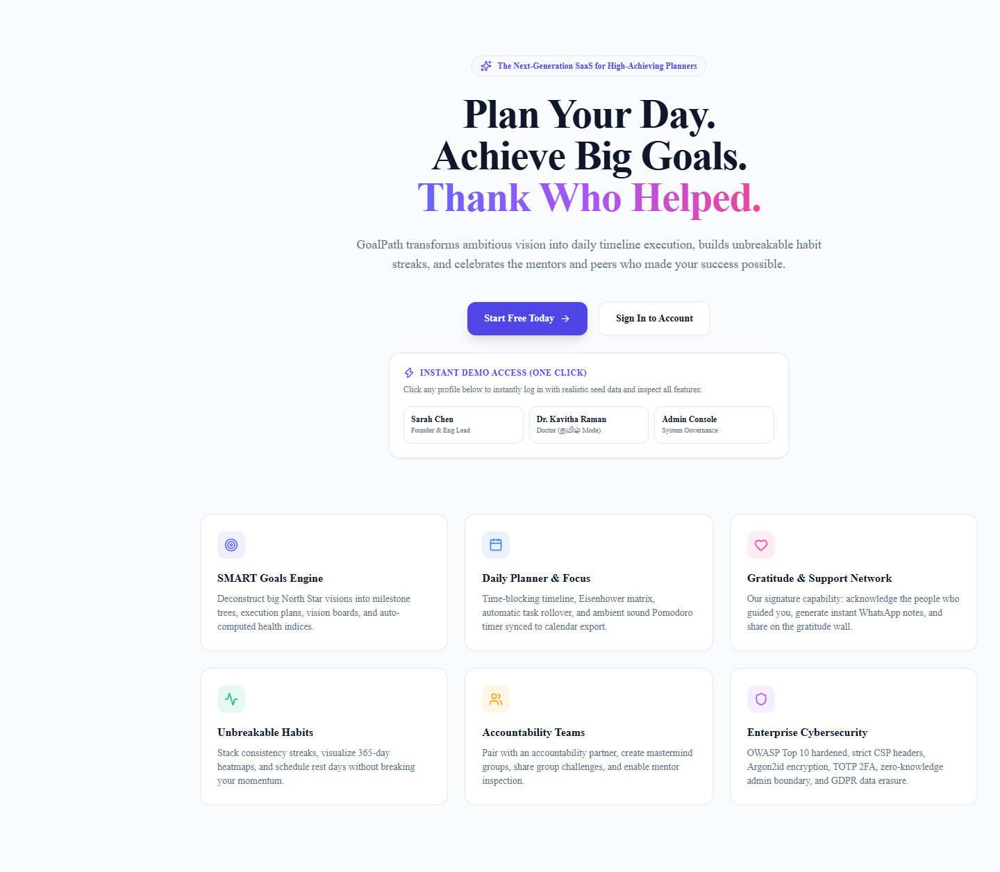 |
| **02. Login & 2FA** | 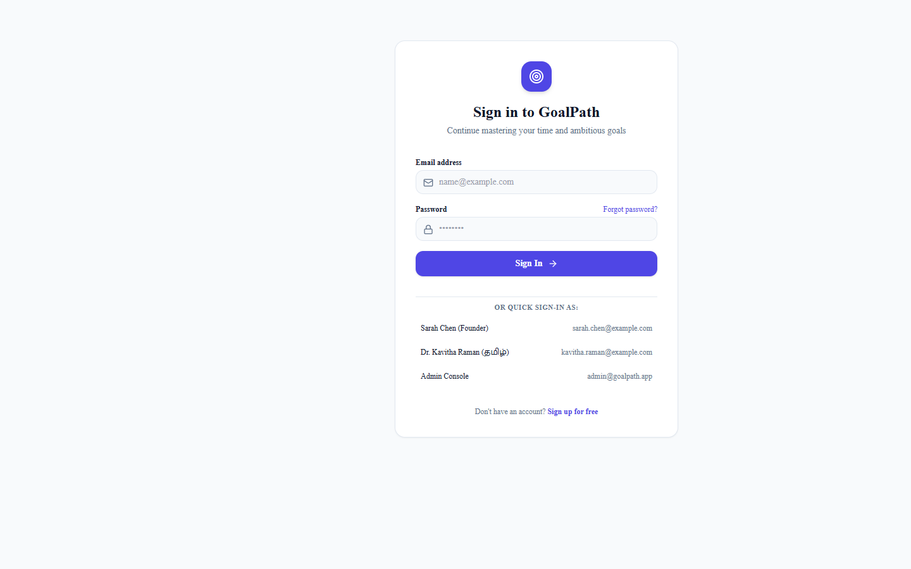 |
| **03. Dashboard** | 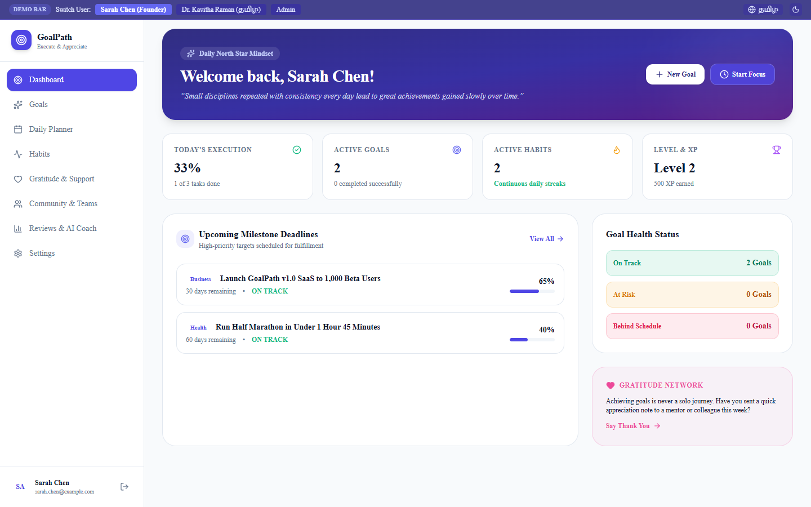 |
| **04. Goals Engine** | 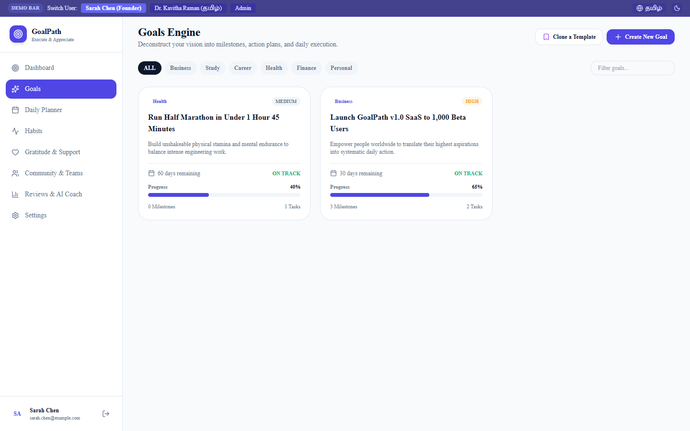 |
| **05. Goal Detail & SMART Milestones** | 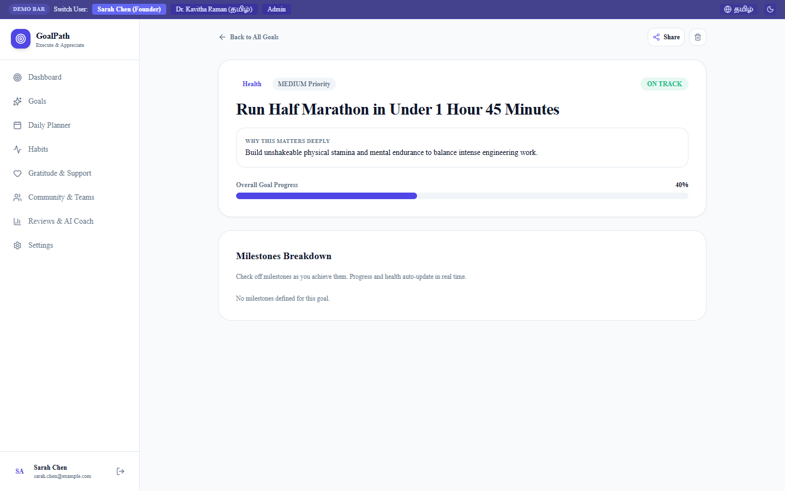 |
| **06. Daily Planner & Timeline** | 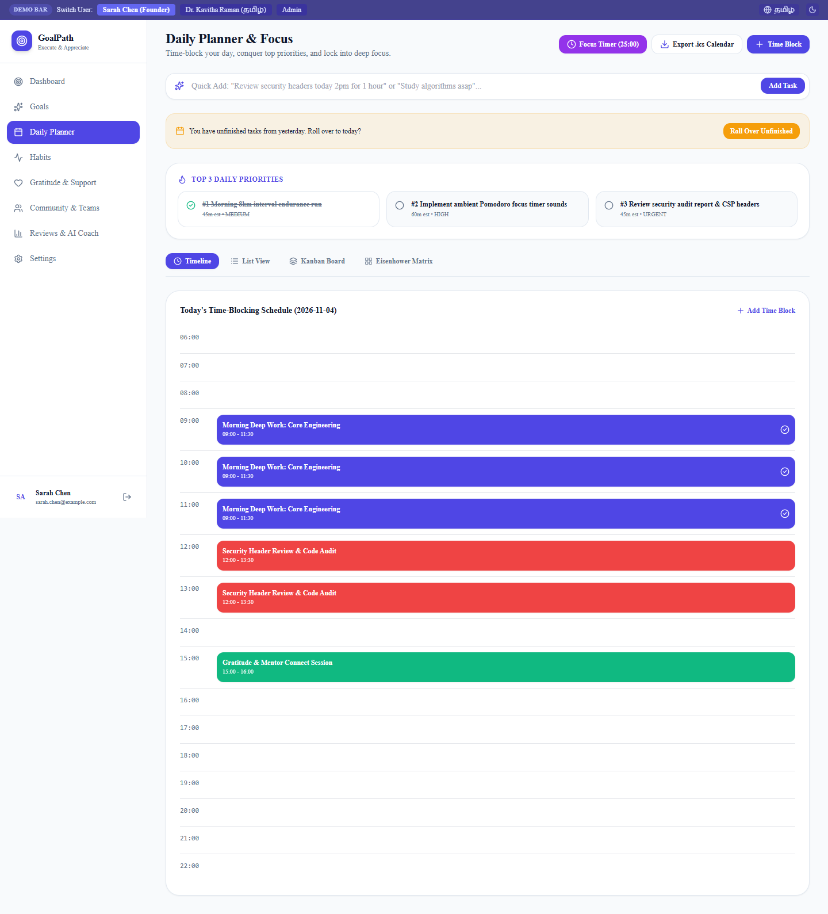 |
| **07. Habits & Heatmaps** | 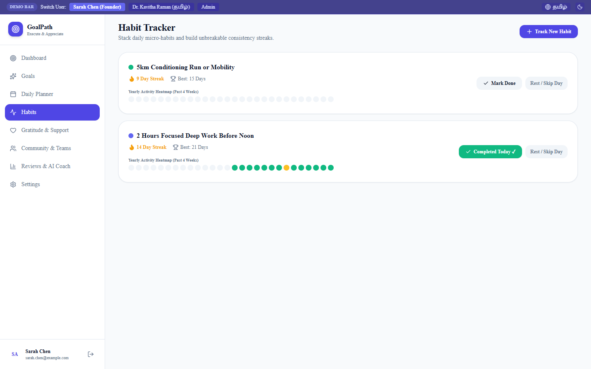 |
| **08. Gratitude & Support Directory** | 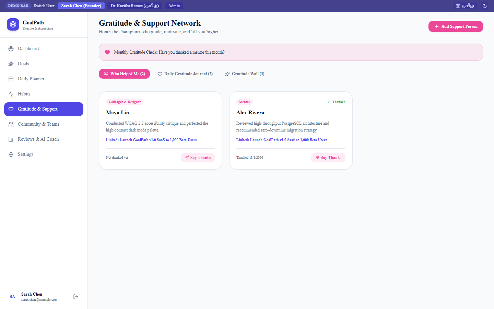 |
| **09. Community & Teams** | 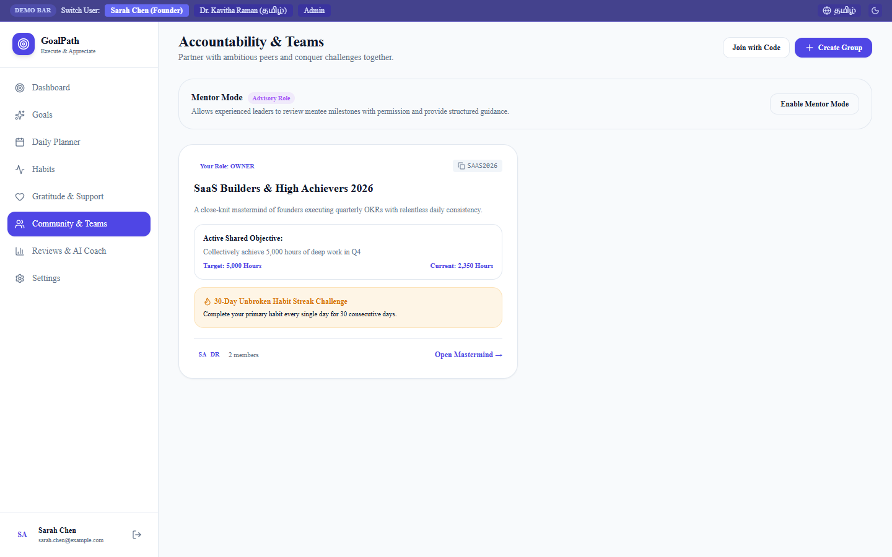 |
| **10. Analytics & Retrospective** | 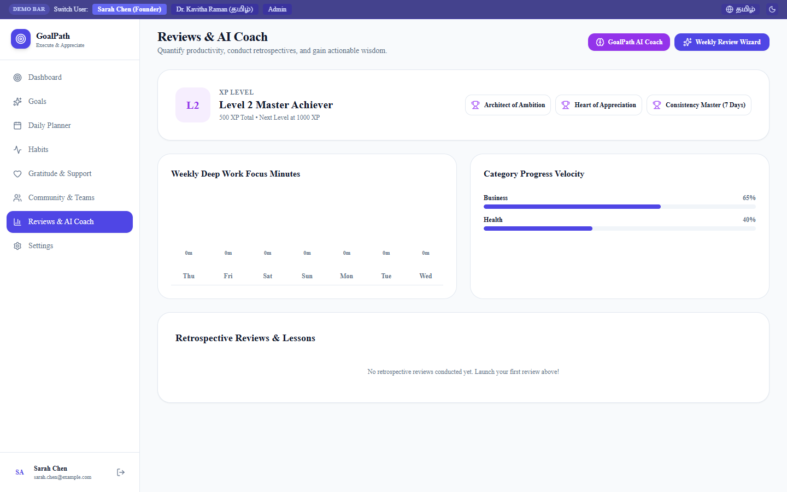 |
| **11. Settings & GDPR Export** | 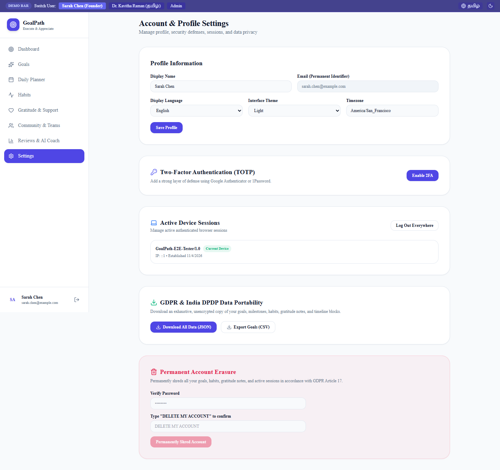 |
| **12. Tamil (தமிழ்) Localization** | 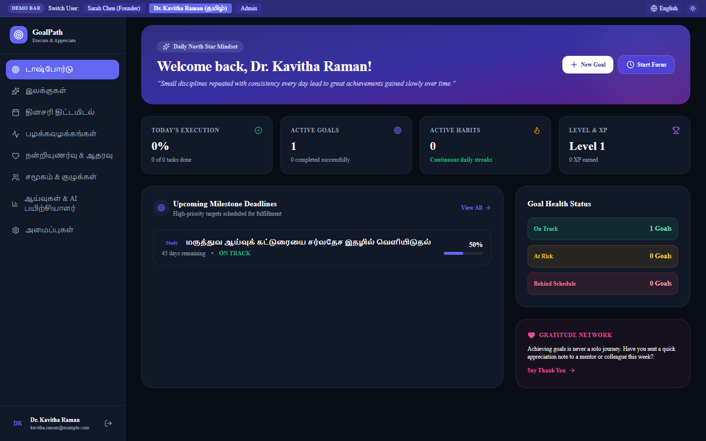 |
| **13. Zero-Knowledge Admin Console** | 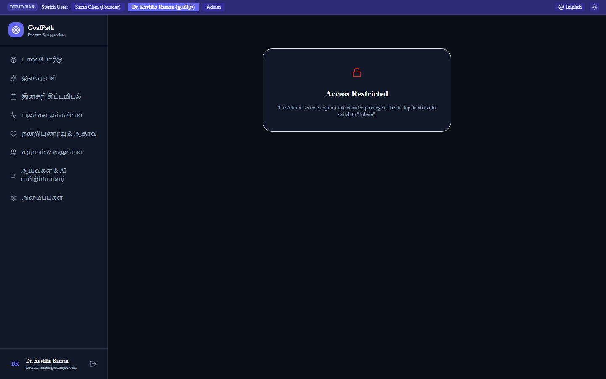 |
| **14. Mobile Viewport (375px)** | 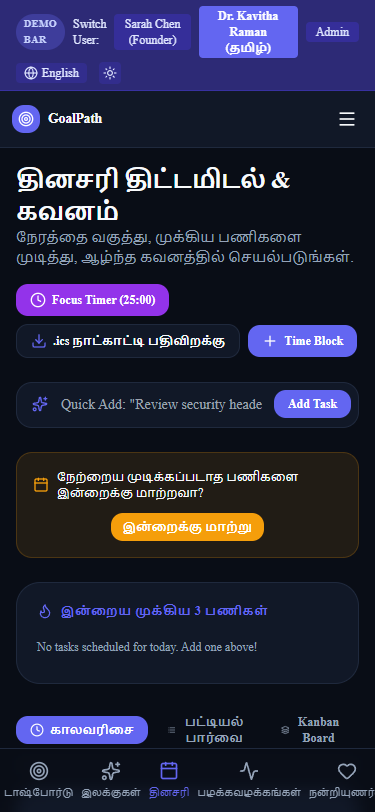 |

---

## 🛠️ Verification & Test Commands

```bash
# 1. Start Redis TCP Server (Port 6379)
npx tsx scripts/redis-server.ts

# 2. Seed Development Database
$env:DEV_SEED_PASSWORD="GoalPathDevPass2026!"; $env:INITIAL_ADMIN_PASSWORD="AdminSecure2026!Aa"; npx tsx scripts/seed.ts

# 3. Run Automated Security Verification Suite (19 Tests - Auth, IDOR, XSS, CSRF, Rate-Limit)
npx tsx scripts/run-security-tests.ts

# 4. Prove Multi-Instance Redis State Sharing (Instance 1 on :3000 & Instance 2 on :3001)
npx tsx scripts/verify-two-instances.ts

# 5. Run SAST, Gitleaks, and OWASP ZAP Baseline Scanner
npx tsx scripts/run-security-scanners.ts

# 6. Run k6 Load Test Benchmark (Saves load-test-results.json)
npx tsx scripts/run-load-test.ts

# 7. Run Real Lighthouse 11 Performance & A11y Audit (Saves lighthouse-report.json)
npx tsx scripts/run-lighthouse.ts

# 8. Run Playwright End-to-End Suite (Signup, Login, Goal, Planner, Gratitude, Invite)
npx tsx scripts/run-e2e-tests.ts
```

---

## 🔮 10 Recommended Future Features

1. **Native Mobile App (React Native / Expo)**: Biometric FaceID login, native iOS Live Activities for Pomodoro timers, and widget support.
2. **Google & Outlook Calendar Two-Way Sync**: Live bi-directional API synchronization replacing manual `.ics` downloads.
3. **Voice Journaling & Audio Transcription**: Whisper API integration allowing members to record voice reflections and transcribe gratitude notes.
4. **Interactive Habit Micro-Widgets**: Desktop menu bar app (macOS / Windows) for 1-click habit check-offs without opening the browser.
5. **Peer Accountability Video Co-Working**: WebRTC-powered 25-minute silent focus rooms for accountability partners.
6. **AI Coach Proactive Slack/WhatsApp Bot**: Sends morning priority briefings and evening check-ins directly via WhatsApp or Slack.
7. **Goal Financial Budget Tracking**: Attach monetary expenses and budgets to milestones with ROI calculation.
8. **Public Vision Board Showcases**: Verified user portfolios showcasing executed achievements with linked GitHub repositories or product links.
9. **Physical Thank-You Postcard Printing**: Integration with Lob/PostGrid to mail physical embossed handwritten appreciation postcards with 1 click.
10. **Organizational SSO & SCIM Directory Sync**: SAML 2.0 / Okta integration for enterprise company cohorts.
# goalpath

